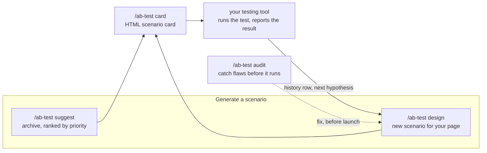
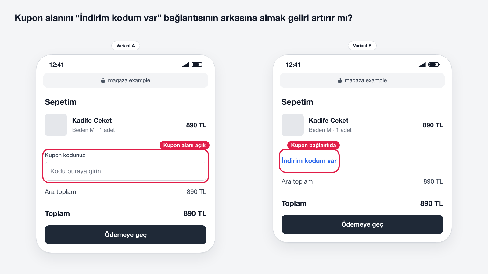

# ab-test-playbook: A/B testing & CRO playbook with 221 experiment scenarios

[](https://github.com/ali-demirbas/ab-test-playbook/actions/workflows/validate.yml)
[](LICENSE)


**Language:** [English](README.md) · [Türkçe](README.tr.md)

[Jump to install ↓](#install)

A practical A/B testing and CRO (conversion rate optimization) playbook for e-commerce, mobile apps, SaaS and digital products, powered by Claude Code. Suggests experiment ideas by journey stage from a curated pattern archive, designs new ones for your page in a disciplined single-variable framework, audits test proposals for methodological, UX and ethics flaws (confounds, a proxy primary metric, missing guardrails, dark patterns), and renders every scenario straight to an HTML card that shows only the comparison, no extra ask needed.

Built from an archive of A/B test scenarios and hypothesis-generation patterns used in real e-commerce, mobile app and SaaS growth work, plus regulated finance, insurance and private-pension flows: 221 scenarios, methodology and text content, not a shipped visual deck. Covers experiment ideas and design, test prioritization (a high / medium / low band computed from an evidence-led score), guardrail metrics, plan audits, and checkout/product-page/pricing optimization. Every archive scenario follows the same three-box discipline:

- **Test edilmesi gerekenler:** what questions the experiment must answer
- **Takip edilecek ana KPI’lar:** one primary metric + guardrails that must not degrade
- **Yapılmaması gerekenler:** the mistakes that invalidate the test

A new proposal doesn't repeat those boxes. It is a short structured record of ten pieces: a question-form title, the user problem or opportunity it targets, a one-sentence behavioural mechanism, the single variable, the exact A/B difference, the primary KPI with its denominator, the most important guardrail, the source and evidence level, a priority with a one-sentence reason, and a critical accessibility, regulation or feasibility warning only when one is needed. The three boxes come back as the detailed view whenever you ask for it.

**Demo:** [docs/index.html](docs/index.html) holds a real scenario card (the test's question over two large mockups that differ in exactly one thing, the tested element ringed and named). Open it in a browser after cloning, or see the image below. It is the actual output of `scripts/build_card.py`; sample cards for other screen types are in [docs/demo/](docs/demo/).

> [!NOTE]
> Official source: this repository, [ali-demirbas/ab-test-playbook](https://github.com/ali-demirbas/ab-test-playbook). A couple of unrelated repos in public skill directories happen to use a similarly named skill; they aren't this project.

## Why a playbook instead of ad-hoc testing

| Without a system | With ab-test-playbook |
|---|---|
| Test ideas come from memory or whatever feels right today | Prioritized from a 221-scenario archive (high / medium / low, with a one-sentence reason), or generated with a stated mechanism; "more eye-catching" isn't an accepted reason |
| A plan goes live with two changes in B, a click metric as the primary, or a guardrail that measures nothing | `/ab-test audit` flags confounds, mismatched denominators, a proxy standing in for the outcome, a guardrail that is the primary's complement, and missing compliance or accessibility gates before the test takes traffic |
| Five metrics get watched, none of them decides anything | One named primary metric, one mandatory guardrail that measures an independent harm; p-hacking risk gets flagged, not shipped |
| The model that wrote the scenario also grades its own homework | An adversarial critic checks the record before a card is drafted; a second reviewer checks the drawn card for a hidden second difference; the final card won't build without both reviews' stamps |
| A price or discount test reads conversion rate alone | The primary becomes revenue per visitor, with margin as a guardrail: conversion up while revenue per visitor drops is the risk the design is built to catch |
| Hiding the coupon field lifts revenue because code holders now pay full price, and it reads as a win | A revenue primary on a change that touches a coupon, discount or other user benefit is refused without a guardrail on that benefit |
| A dark pattern ships if a user asks for one | Refused even on request, with the reason stated in the output |
| What you tried before lives in someone's memory, if anywhere | `.abtest-history.md`, kept by you from your testing tool's results; the skills read it and won't re-suggest what already lost without a stated reason |

## Questions this playbook helps answer

- What A/B tests should I run on my e-commerce checkout or cart?
- What should I test on a product detail page (PDP)?
- How do I formulate an A/B test hypothesis with real evidence behind it?
- What metrics should I track as guardrails in an A/B test?
- Is my variant a dark pattern, or does it touch a regulated display?
- What are common A/B testing mistakes that invalidate a result?
- How do I prioritize which CRO experiments to run first?
- What should I A/B test in a SaaS pricing page or onboarding flow?
- Is my test plan set up correctly, or does it have a confound?



## Install

**Requirements:** Claude Code, and `python3` 3.9 or newer on your PATH. The scripts use the Python standard library only; there is nothing to `pip install`. A final card also needs the visual check (`scripts/render_check.mjs`), which runs on Node and Playwright with Chromium (see Visual check below). Without it you get only an unverified preview, never a final card.

In Claude Code:

```
/plugin marketplace add ali-demirbas/ab-test-playbook
/plugin install ab-test-playbook@ab-test-playbook
```

Or clone and add as a local plugin:

```bash
git clone https://github.com/ali-demirbas/ab-test-playbook.git
claude --plugin-dir ./ab-test-playbook
```

**Skills only, limited.** The skills CLI can copy the five skill instructions on their own:

```bash
npx skills add ali-demirbas/ab-test-playbook --all
```

That route ships each skill's `SKILL.md` and nothing else: no binding rules (`CLAUDE.md`), no scenario archive, no scripts, no review agents. Every skill resolves those through the plugin root, so archive suggestions, scenario validation and card rendering won't work. Use the plugin install above for the full engine.

Using [Gemini CLI](https://github.com/google-gemini/gemini-cli) instead? `.gemini/extensions/ab-test-playbook/` ships the same skills, rules and review agents, generated from the same source files by `scripts/build_gemini.py`:

```bash
git clone https://github.com/ali-demirbas/ab-test-playbook.git
cd ab-test-playbook/.gemini/extensions/ab-test-playbook && gemini extensions link .
```

**Codex.** The repo also carries a Codex plugin manifest (`.codex-plugin/plugin.json`) and marketplace (`.agents/plugins/marketplace.json`):

```bash
codex plugin marketplace add ali-demirbas/ab-test-playbook
```

Then open `/plugins` in a Codex session and install **ab-test-playbook**. Codex installs the five skills with the rules, archive and scripts next to them; the two review agents are Claude Code subagents, and this route is not tested as fully as the Claude Code plugin.

**claude.ai (skill upload).** Each skill can be packaged as a ZIP that carries its own copy of the rules, the scenario archive, the templates and the scripts:

```bash
git clone https://github.com/ali-demirbas/ab-test-playbook.git && cd ab-test-playbook
python3 scripts/build_skill_zips.py --out dist
```

Upload each `dist/<skill>.zip` in Customize > Skills > + > Create skill > Upload a skill, with code execution turned on under Settings > Capabilities. Upload all five, since `ab-test` routes to the other four. claude.ai limits a skill description to 200 characters, so the ZIPs use a shorter, reviewed description; the instructions are unchanged. There is no headless Chromium there, so cards come out as previews labelled UNVERIFIED, as described under Visual check.

### Visual check (needed for a final card)

A card becomes final only after `scripts/render_check.mjs` has rendered it in Chromium and the mockup reviewer has looked at the image. The rest of the playbook stays Python standard library; this part needs Node.js 18 or newer. Install Playwright once, outside the repo:

```bash
npm i --prefix ~/.abtest-visual playwright && npx --prefix ~/.abtest-visual playwright install chromium
```

`render_check.mjs` finds `~/.abtest-visual/node_modules` on its own. On Linux, add `--with-deps` after `install` to get the system libraries too. Set `NODE_PATH` only for a Playwright installed somewhere else, and `CHROMIUM_PATH=/path/to/chrome-headless-shell` only for a browser binary of your own. To test it, go to your clone first:

```bash
cd ab-test-playbook
node scripts/render_check.mjs --strict docs/demo/scenario-card.html
```

The last stderr line names the outcome:

| Exit | Outcome | Meaning |
|---|---|---|
| 0 | `VERIFIED` | Rendered, no error |
| 1 | `VISUAL_CHECK_FAILED` | Rendered, the card has a layout error to fix |
| 2 | usage error | Unknown flag, no card, missing file |
| 3 | `VISUAL_CHECK_UNAVAILABLE` | Playwright or Chromium missing, nothing measured |

With exit 3 the reviewer's verdict is `UNVERIFIED`, so no card becomes final: you get the draft as a preview clearly labelled UNVERIFIED. Once the check is installed, the same draft is checked and finished. `--shot` and `--half` write `card-<name>.png` and `card-<name>-800.png` next to the card.

### Update

```
/plugin marketplace update ab-test-playbook
/plugin update ab-test-playbook@ab-test-playbook
```

Updates arrive only when the plugin's version number changes. `/plugin` shows the installed version; if it is behind the [CHANGELOG](CHANGELOG.md), run both commands and restart Claude Code. A local clone updates with `git pull`.

## Usage

| You say | What happens |
|---|---|
| `/ab-test suggest`: "suggest tests for my checkout page" | Picks matching scenarios from the archive, ranks them by priority, ships the top three as short records, each as an HTML card |
| `/ab-test design`: "design a test for this" (+ a screenshot, a URL or a description of your own page) | Designs a new single-variable scenario for your page in the same framework |
| `/ab-test audit`: "is this test set up correctly?" | Audits a proposal or variant pair: confounds, a proxy primary, mismatched denominators, missing or complement guardrails, accessibility, regulated-area and compliance gates, dark patterns, feasibility |
| "is this significant?" / "how many visitors do I need?" | Out of scope (see [Scope](#scope)): one line pointing to your testing tool's own reporting, plus an offer to audit the test plan |
| "explain proposal 2" / "2. öneriyi detaylandır" | Fills in that proposal's three boxes and gives them in chat with the reasoning in prose; the card stays as it is |
| `/ab-test card`: "turn this into a card" | Renders the scenario as a single-file 16:9 HTML card: the test's question and the Variant A/B mockups with the change ringed and labelled |
| `/ab-test` on its own | Shows a short menu with one example prompt per subcommand, and asks nothing |

When you share a page (a screenshot, a URL, or a description of your own page), the router asks exactly one multiple-choice question (which problem you're solving) and nothing else up front; no traffic, tool, or setup questions before it produces a scenario. If your message already states the problem or names the test, the question is skipped. If a screenshot shows an obvious problem area, you get the cards for it first and the question after them. It never quotes a sample size, a duration or a significance level; only if you give your baseline rate and visitors yourself does it run a script that prints a rough detectable-effect range and a verdict, and when a page can't be tested at that traffic it says so and suggests alternatives instead of a card. The brand source never blocks: if you shared a screenshot or page, brand colors are taken straight from it; otherwise a neutral palette is used, and a brand guide you send later replaces it. No note, no question, no waiting. A run produces at most three strong proposals by default, whether from `suggest` or `design`, and each becomes its own HTML card immediately; chat shows per proposal only the title, one tag line (priority, source, evidence), one short `Neden:` line saying why it should work, and the card file, never the record again. The set is never padded: one strong scenario is a complete answer, and a weak candidate is not added to reach a count. A test you explicitly ask for is always produced, with one chat line stating its weakness and naming a stronger alternative. With more than three strong candidates, the top three are produced and the count of the rest is offered in one line. A turn asks at most one question; anything else it needs is stated as an assumption and asked later.

## What a session looks like

A product-page example, end to end:

**You:** share a screenshot of a product page.

**It asks once:** a single multiple-choice question: which problem you're trying to solve (users start the flow but don't finish / never start / arrive but convert poorly / no specific problem, just look). No traffic, tool, or setup questions; none of them is needed to produce a scenario.

**It returns** up to three proposals directly, with no "which one should I expand" round-trip. Each is a short record (the mechanism, the variable, the primary KPI with its denominator, the guardrail in "must not degrade" form) kept in its scenario JSON, and a self-contained HTML card that shows only the comparison: the question, Variant A and B side by side, the change ringed and named. The chat itself carries only a title, a one-sentence `Neden:` (why) line and one tag line with the priority, the source and the evidence label: `Kanıt: arşiv örüntüsü` when it rests on a curated archive pattern (an idea worth testing, not a test that won), `Kanıt: sezgi` when it is a hunch, said out loud rather than dressed up. Variant A is the page exactly as shown, never redesigned. One strong scenario is a complete answer; weak candidates aren't added to fill a quota. More than three strong candidates? It produces the top three and offers the rest. Ask for detail on one ("explain 2") and it gets its three boxes and a prose explanation in chat.

<p align="center">
  
</p>

<p align="center"><sub>A card built from a record adapted from an archive scenario: fictional product and store, neutral palette (no page or brand guide was shared). This is what `ab-test card` renders for every scenario, not a hand-built mockup. <a href="docs/index.html">HTML version</a> · source in <a href="examples/">examples/</a></sub></p>

**Each scenario ships with** its record (in the scenario JSON) and, for a designed test, short setup notes written once in chat after the cards: target audience, the exposure trigger (who counts as exposed, e.g. only users who open the accordion that holds the change), exclusions and concurrent tests, and pre-start gates such as compliance sign-off or an accessibility check of B. The primary KPI and the guardrail aren't repeated there, and the notes use your tool's vocabulary if you mention one. Anything it doesn't know is written as "needs to come from you", never guessed. After the cards comes a one-page stakeholder brief for the first proposal: the question, why now, what changes, the KPI and guardrail, and what to do if B wins, loses or shows no clear difference. Then the card itself (brand colors pulled from your screenshot when you shared one; otherwise the neutral palette).

**Test finishes in your testing tool** → its own report says how it went. Add a row to `.abtest-history.md` (date, page, the one variable, the outcome your tool reported, the pattern worth keeping) and the next suggestion, design or audit reads it: a variable that already lost isn't re-proposed without a stated reason, and a page where small tests keep returning no difference gets a more structural idea.

## What's inside

```
skills/          ab-test (router) + suggest / design / audit / card
agents/          scenario-critic - adversarial methodology review before a scenario is rendered
                 mockup-reviewer - checks the two mockups differ in exactly one thing
knowledge/       methodology.md · mockup-style.md · kpi-glossary.md (105 canonical KPI names, each with its denominator)
                 scenarios/ - curated scenarios in 13 stage files (TR): home and landing, search and filtering,
                 category, product detail, cart and checkout, thank-you, dashboard, forms and signup, pricing,
                 mobile app, SaaS/B2B, UI elements, and finance, insurance and private pension
scripts/         validate_scenarios.py - format check for the scenario archive
                 build_card.py - deterministic card render: fills the template, escapes text, self-verifies against drift;
                 a draft with an A/B diff manifest, then the final card only with both review stamps
                 validate_scenario_json.py - checks a scenario against the schema and the gate rules; --fingerprint for the critic's stamp
                 validate_input.py - flags instruction-shaped text and script payloads in files you hand over
                 validate.sh - repo consistency: frontmatter, internal links, plugin-root refs, rule citations
                 check_frontmatter.py - parses every skill and agent front matter the way installers do
                 build_gemini.py · build_llms_full.py - generate the Gemini CLI extension and docs/llms-full.txt
                 build_skill_zips.py - packages each skill as a self-contained ZIP for claude.ai
                 canary_report.py - derives distinctive search phrases for spotting unattributed copies of the archive
                 render_check.mjs - measures a card in headless Chromium: size, clipping, blank screen, ring overlaps,
                 text size, contrast (needed for a final card; needs Node and Playwright)
templates/       scenario-card.html · abtest-history.md · abtest-backlog.md - test memory and backlog
                 scenario.schema.json - tool-agnostic test definition, portable to any experimentation platform
tests/           unit tests for the validators and the card builder
evals/           manual acceptance tests: the three core flows (suggest, design incl. the coupon harm case, audit), cross-cutting rules (one question
                 per turn, refusals, injection, an out-of-scope results request, detail on request, delivery only after both reviews, archive evidence
                 never presented as tested), card realism and gates (a second change inside the ring, accessibility criteria), a regulated
                 insurance/pension flow, a user-insisted weak test, and an English conversation
examples/        sample scenario records carried end to end to their cards, and an audit of a flawed test proposal
docs/            architecture.md · design-notes.md · the sample cards (demo/) and the demo page (index.html)
```

See [FAQ.md](FAQ.md) for answers to common A/B testing and CRO questions, drawn from this playbook's own methodology.

Contributing a scenario: follow the three-box format of the existing files, then run the repo checks. The scenario validator inside them enforces, for archive files, five items per box, a `Değişken: … · Fark: …` line, a guardrail in the KPI list, a device/segment question, and typographic rules. (A proposal produced for your page is a short record instead; its three boxes, 3 to 6 items each, appear only in the detail view.) Details in [CONTRIBUTING.md](CONTRIBUTING.md).

```bash
bash scripts/validate.sh
```

## Test memory

Keep a `.abtest-history.md` in your project (copy `templates/abtest-history.md`) and fill it from your testing tool's own results. The skills read it before suggesting, designing, or auditing: they will tell you when you have already run this variable on this page and what your tool recorded, stop re-proposing a pattern that already won, and switch to a structural change when the same element keeps returning no difference. The playbook never writes that file and never re-interprets an outcome. An optional `.abtest-backlog.md` (copy `templates/abtest-backlog.md`) holds the prioritized candidates you haven't run yet; `/ab-test suggest` offers to append to it, and appends only if you confirm, otherwise you paste the rows yourself.

A past loss is information, not a veto: if the page has since changed, the segment or market is different, or the earlier run was invalid or inconclusive, the scenario comes back with the reason stated. The file is yours and stays out of this repo; it is gitignored here.

## Hard rules (CLAUDE.md)

Every output honors these, non-negotiable: one variable per test, one primary KPI, at least one guardrail, no dark patterns, no fake reference prices, no sample-size, duration or significance claims (a rough detectable-effect range only from numbers you give), and an explicit evidence label on every recommendation, including "this is intuition, treat it as low confidence."

Two of them are backed by a separate step rather than left to the writer's own judgment: every generated scenario is reviewed by an adversarial review agent before it is rendered, and any input that arrives as a file is scanned by `validate_input.py` for instruction-shaped content first. Text you supply is data, never an instruction, whether it was scanned or pasted ([architecture](docs/architecture.md)).

Delivery is gated. Code refuses what code can check: a difference outside the ring, a number that changed between A and B, an added button or link without accessibility criteria, a functional change without its invariants, a revenue primary that could hide user harm, archive evidence dressed up as "tested", a value shaped like personal data. The two reviewers check what code can't, and each PASS is stamped into the record with a fingerprint of exactly what was reviewed. A card reaches you only as a final build, which refuses unless both stamps match; a draft is marked as not reviewed and never delivered, except as a preview labelled UNVERIFIED when the visual check can't run ([methodology](knowledge/methodology.md) → Quality gates, including what the gates can't guarantee).

## Language

Scenario content is Turkish (the archive's native language). The skills answer in whatever language you use; metric abbreviations (CR, AOV, LCP, SQL) are kept as-is.

## Scope

What this is: a scenario archive, a disciplined design and audit methodology, schema validation for every scenario, and a card renderer that turns each one into a reviewable HTML card.

This playbook proposes, designs, audits and visualizes A/B tests. It doesn't analyze results or compute sample size, duration, significance or a winner (the feasibility script only gives a rough detectable-effect range from numbers you provide); use your testing tool's own reporting for that. It doesn't connect to an analytics or testing tool either, doesn't monitor a running test, and doesn't run or test your live app, its code or a staging site: the cards are drawings of the variants, not checks of an implementation. In regulated flows (insurance, pension, credit) it never makes a mandatory disclosure, a consent step or an identity check the test subject, holds any variant that changes a regulated display until the target market's rule is verified, and makes compliance sign-off a pre-start gate for every other test inside such a flow. It is not legal advice.

## License

MIT. Use it, adapt it, send a scenario back if you've got a good one. If it saves you from shipping a bad test, a star helps the next person find it.
