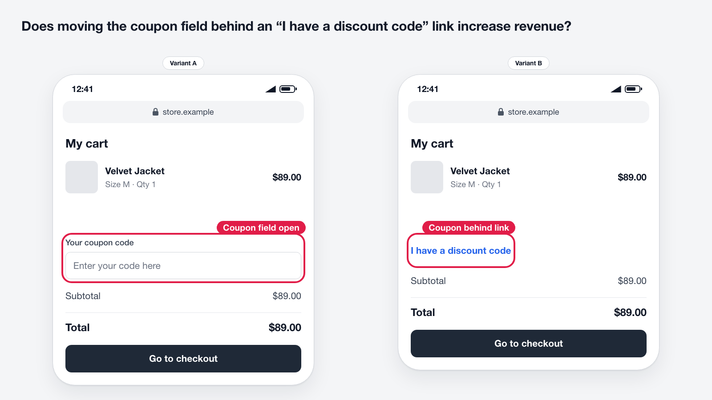

# A/B Test Builder

[](https://github.com/ali-demirbas/ab-test-playbook/actions/workflows/validate.yml)
[](LICENSE)


**Language:** [English](README.md) · [Türkçe](README.tr.md)

Turn a screenshot of your page into single-variable A/B test plans, each with one primary KPI and one guardrail (a metric that must not get worse), reviewed by two agents and drawn as a side-by-side card. It runs inside Claude Code.

<p align="center">
  <a href="https://ali-demirbas.github.io/ab-test-playbook/"></a>
</p>

<p align="center"><sub>A real card, as the plugin draws it for every test: fictional store, neutral colors. <a href="https://ali-demirbas.github.io/ab-test-playbook/">Live demo</a> · <a href="docs/demo/">more sample cards</a></sub></p>

- **You give:** a screenshot, a URL or a short description of your page. Nothing to share yet? Name a page type ("my checkout") and it picks ideas from an archive of 217 curated scenarios.
- **You get:** one to three test plans. Each has one change, the reason it should work, one primary KPI and one guardrail, and comes as an HTML card with A and B side by side and the change ringed.
- **It does not:** calculate sample size, duration, significance or a winner, connect to your analytics or testing tool, or touch your live site. Results stay in your testing tool.

Made for growth, CRO and product people who decide what to test next. You don't need to write code.

> **One name to know:** the plugin's display name is A/B Test Builder. It installs as `ab-test-playbook`, and the command is `/ab-test`. Official source: this repository. Similarly named skills in public directories are not this project.

## First card in 3 steps

**Requirements:** Claude Code and Python 3.9 or newer. Node 18 or newer and Playwright are needed only for the final visual check (step 2). New to the terminal? [Start here](docs/install.md#new-to-the-terminal).

**1. Install the plugin.** Type these in Claude Code:

```
/plugin marketplace add ali-demirbas/ab-test-playbook
/plugin install ab-test-playbook@ab-test-playbook
```

**2. Turn on the visual check (optional, recommended).** Run this once in a terminal:

```bash
npm i --prefix ~/.abtest-visual playwright && npx --prefix ~/.abtest-visual playwright install chromium
```

Skip it and you still get your cards, as previews marked "not visually checked". Run it later and the same cards get checked and finished.

**3. Ask for a card.** Paste a screenshot of your page into Claude Code and type:

```
/ab-test design a test for this page
```

No screenshot at hand? Start from the archive:

```
/ab-test suggest tests for my checkout page
```

It asks at most one question (which problem you are solving) and never asks for traffic, tools or budget. Typing `/ab-test` alone shows a short menu.

Using Codex, Gemini CLI or claude.ai, updating, or something looks off? See [install, update and troubleshooting](docs/install.md).

## Fewer permission prompts

Claude Code asks before each script the plugin runs. To allow only the plugin's own scripts once, print the plugin folder:

```bash
python3 -c "import json,os;d=json.load(open(os.path.expanduser('~/.claude/plugins/installed_plugins.json')))['plugins'];print([i['installPath'] for k,v in d.items() if k.startswith('ab-test-playbook@') for i in v][0])"
```

Then add this to `~/.claude/settings.json`, with `<PLUGIN_ROOT>` replaced by that path. After a plugin update, run the line again and replace the path. What each rule covers: [install guide](docs/install.md#fewer-permission-prompts).

```json
{"permissions": {
  "additionalDirectories": ["<PLUGIN_ROOT>"],
  "allow": [
    "Bash(python3 <PLUGIN_ROOT>/scripts/validate_scenario_json.py *)",
    "Bash(python3 <PLUGIN_ROOT>/scripts/new_record.py *)",
    "Bash(python3 <PLUGIN_ROOT>/scripts/build_card.py *)",
    "Bash(python3 <PLUGIN_ROOT>/scripts/read_section.py *)",
    "Bash(python3 <PLUGIN_ROOT>/scripts/validate_input.py *)",
    "Bash(python3 <PLUGIN_ROOT>/scripts/feasibility.py *)",
    "Bash(node <PLUGIN_ROOT>/scripts/render_check.mjs *)",
    "Bash(test -d *)",
    "Bash(node -e \"require.resolve('playwright')\")"
  ]
}}
```

## What you can ask

| You say | What happens |
|---|---|
| `/ab-test design`: "design a test for this" plus a screenshot, URL or description | Designs up to three new single-variable tests for your page, each with a card |
| `/ab-test suggest`: "suggest tests for my product page" | Picks matching ideas from the archive, ranks them high, medium or low, and draws the top three |
| `/ab-test audit`: "is this test set up correctly?" plus your plan | Checks a plan before it takes traffic: two changes in one variant, a click standing in for the real outcome, a missing guardrail, accessibility and compliance gaps, dark patterns. Ends with a fixed plan it can turn into a card |
| `/ab-test card`: "turn this into a card" | Draws a scenario you already have as a card |
| "explain proposal 2" | Gives the detail behind one proposal in chat: what to test, which KPIs to track, what not to do |
| "quick draft" | The same cards in minutes, not reviewed yet and labelled so; say "finish" and both reviews run |
| "is this significant?" | Out of scope. One line pointing to your testing tool's report, and an offer to audit the plan |

Every command, the full session walkthrough and the test memory file (`.abtest-history.md`, so a test that already lost is not suggested again) are in the [reference](docs/reference.md), with an [8-term glossary](docs/reference.md#glossary) for words like guardrail, primary KPI and exposure.

## Why use it

| Without a system | With A/B Test Builder |
|---|---|
| Test ideas come from memory or whatever feels right today | Ideas come ranked from a 217-scenario archive, or are designed for your page with a stated reason. "More eye-catching" is not accepted as a reason |
| Variant B quietly changes two things, so the result can't be explained | One variable per test. A second reviewer looks at the drawn card for a hidden second difference |
| Five metrics get watched, none of them decides | One primary KPI decides, one guardrail protects what must not get worse |
| Hiding the coupon field lifts revenue because code holders now pay full price, and it reads as a win | A revenue goal on a change that touches a user benefit is refused without a guardrail on that benefit |

The full comparison is in the [reference](docs/reference.md#why-a-playbook-instead-of-ad-hoc-testing).

## What keeps it honest

- **Rules it does not bend:** one variable, one primary KPI, at least one guardrail, no dark patterns, no fake reference prices, no made-up statistics. The 19 binding rules are in [CLAUDE.md](CLAUDE.md).
- **Evidence is labelled.** An archive pattern is an idea worth testing, not a test that won. A hunch is called a hunch.
- **Two reviews before delivery.** One agent challenges the test plan, another checks the drawn card. A card is final only after both. How this works is in the [architecture](docs/architecture.md) notes.
- **Regulated flows** (insurance, pension, credit): mandatory disclosures, consent steps and identity checks are never test subjects. Not legal advice. Details under [Scope](docs/reference.md#scope).

## Language

The skills answer in the language you write in, and cards follow it. The scenario archive is bilingual: an English conversation reads each scenario in English, a Turkish one in Turkish. Metric abbreviations (CR, AOV, LCP) stay as they are.

## More

- [Live demo](https://ali-demirbas.github.io/ab-test-playbook/): sample cards in English and Turkish
- [FAQ](FAQ.md): what to test first, guardrails, low traffic, common mistakes
- [Reference](docs/reference.md): all commands, a full session, what is in the repo, scope
- [Examples](examples/): a scenario record carried end to end, and an audit of a flawed plan
- [Contributing](CONTRIBUTING.md) · [Changelog](CHANGELOG.md) · [Privacy](PRIVACY.md)
- Something not working? [Open an issue](https://github.com/ali-demirbas/ab-test-playbook/issues)

## License

MIT. Use it, adapt it, send a scenario back if you've got a good one. If it saves you from shipping a bad test, a star helps the next person find it.

---

Built by [Ali Demirbaş](https://alidemirbas.com.tr)
