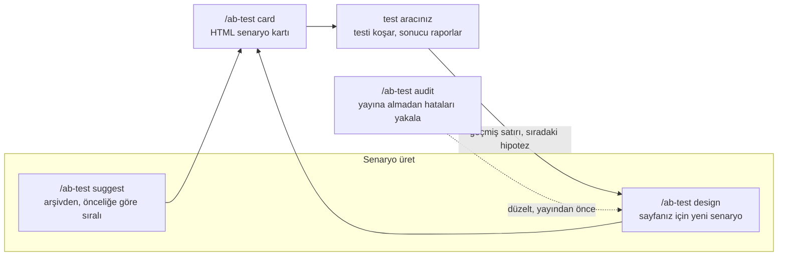
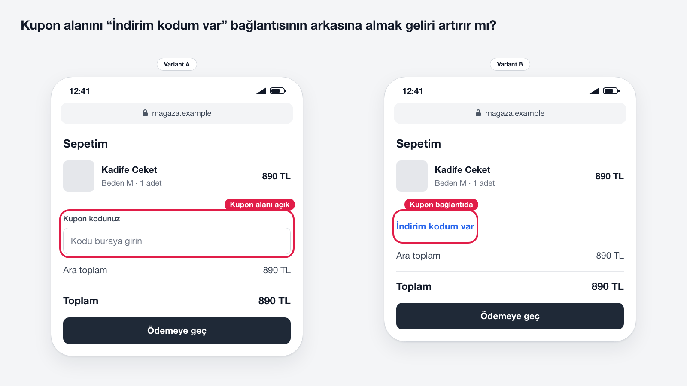

# ab-test-playbook: 221 deney senaryolu A/B test ve CRO rehberi

[](https://github.com/ali-demirbas/ab-test-playbook/actions/workflows/validate.yml)
[](LICENSE)


**Dil:** [English](README.md) · [Türkçe](README.tr.md)

[Kuruluma atla ↓](#kurulum)

E-ticaret, mobil uygulama, SaaS ve dijital ürünler için pratik bir A/B test ve CRO (dönüşüm oranı optimizasyonu) rehberi; Claude Code üzerinde çalışır. Derlenmiş bir örüntü arşivinden, yolculuk aşamasına göre deney fikirleri önerir, sayfanız için disiplinli tek-değişkenli bir çerçevede yenilerini tasarlar, test önerilerini metodolojik, UX ve etik hatalara karşı denetler (confound, vekil birincil metrik, eksik guardrail, dark pattern) ve her senaryoyu doğrudan yalnızca karşılaştırmayı gösteren bir HTML karta çevirir. Ayrıca istemek gerekmez.

Gerçek e-ticaret, mobil uygulama ve SaaS büyüme çalışmalarında, ayrıca düzenlemeye tabi finans, sigorta ve bireysel emeklilik akışlarında kullanılan bir A/B test senaryosu ve hipotez üretim deseni arşivinden inşa edildi: 221 senaryo, metodoloji ve metin içeriği, hazır bir görsel deste değil. Deney fikri ve tasarımı, test önceliklendirme (gerekçesi yazılı Yüksek / Orta / Düşük öncelik), guardrail metrikleri, plan denetimi ve checkout/ürün sayfası/fiyatlandırma optimizasyonunu kapsar. Arşivdeki her senaryo aynı üç-kutu disiplinini izler:

- **Test edilmesi gerekenler**: deneyin hangi soruları yanıtlaması gerektiği
- **Takip edilecek ana KPI’lar**: bir birincil metrik + bozulmaması gereken guardrail’ler
- **Yapılmaması gerekenler**: testi geçersiz kılan hatalar

Yeni bir öneri bu kutuları tekrarlamaz. On parçalık kısa, yapılandırılmış bir kayıttır: soru biçiminde bir başlık, hedeflediği kullanıcı problemi ya da fırsat, tek cümlelik davranışsal mekanizma, tek değişken, A ile B arasındaki tam fark, paydasıyla birincil KPI, en önemli guardrail, kaynak ve kanıt düzeyi, tek cümlelik gerekçesiyle öncelik ve yalnızca gerektiğinde kritik bir erişilebilirlik, düzenleme ya da uygulanabilirlik uyarısı. Üç kutu, istediğiniz an ayrıntılı görünüm olarak geri gelir.

**Kurulumsuz demo:** gerçek bir senaryo kartı (üstte testin sorusu, altında tam olarak tek bir şeyde farklılaşan iki büyük mockup, test edilen öğe halkayla işaretli ve adlandırılmış) [ali-demirbas.github.io/ab-test-playbook](https://ali-demirbas.github.io/ab-test-playbook/) adresinde. Bu, `scripts/build_card.py`’nin gerçek çıktısıdır, bir resmi değil; başka ekran türleri için örnek kartlar [docs/demo/](docs/demo/) klasöründe.

> [!NOTE]
> Resmi kaynak: bu repo, [ali-demirbas/ab-test-playbook](https://github.com/ali-demirbas/ab-test-playbook). Herkese açık skill dizinlerinde ilgisiz birkaç repo tesadüfen benzer isimli bir skill kullanıyor; bu projeyle alakaları yok.

## Neden rastgele test etmek yerine bir rehber

| Rehber olmadan | ab-test-playbook ile |
|---|---|
| Test fikirleri hafızadan ya da o gün akla gelenden gelir | 221 senaryoluk arşivden önceliğe göre sıralanır (Yüksek / Orta / Düşük, tek cümlelik gerekçeyle) ya da belirtilmiş bir mekanizmayla üretilir; “daha dikkat çekici olur” kabul edilen bir gerekçe değildir |
| Plan, B’de iki değişiklikle, birincil metrik olarak bir tıklamayla ya da hiçbir şey ölçmeyen bir guardrail’le yayına girer | `/ab-test audit` confound’ları, uyuşmayan paydaları, asıl sonucun yerine geçen vekil metriği, birincilin tümleyeni olan guardrail’i ve eksik uyum ya da erişilebilirlik kapılarını test trafik almadan önce işaretler |
| Beş metrik izlenir, hiçbiri kararı vermez | Adı konmuş tek bir birincil metrik ve bağımsız bir zararı ölçen zorunlu bir guardrail; p-hacking riski işaretlenir, yayınlanmaz |
| Senaryoyu yazan model kendi ödevini kendi notlandırır | Kart taslağı çıkmadan önce kaydı bir adversarial denetçi kontrol eder; ikinci bir denetçi çizilen kartta gizli ikinci farkı arar; iki incelemenin damgası olmadan nihai kart üretilmez |
| Fiyat veya indirim testi yalnızca dönüşüm oranına bakar | Birincil metrik ziyaretçi başına gelir olur, marj guardrail olarak eklenir; dönüşüm artarken ziyaretçi başına gelirin düşmesi tasarımın yakalamak için kurulduğu risktir |
| Kupon alanını gizlemek geliri artırır, çünkü kodu olan kullanıcı artık tam fiyat öder; bu bir kazanç gibi okunur | Kupon, indirim ya da başka bir kullanıcı faydasına dokunan değişiklikte gelir birincil metrikse o faydayı koruyan guardrail olmadan kayıt reddedilir |
| Kullanıcı isterse dark pattern yayına girer | İstense bile reddedilir, nedeni çıktıda söylenir |
| Daha önce denenen bir şey varsa birinin hafızasında kalır, o kadar | `.abtest-history.md`, test aracınızın sonuçlarından sizin tuttuğunuz dosya; skill’ler bunu okur ve gerekçesiz olarak zaten kaybetmiş bir şeyi tekrar önermez |

## Bu rehberin cevapladığı sorular

- E-ticaret checkout veya sepetimde hangi A/B testlerini çalıştırmalıyım?
- Ürün detay sayfasında (PDP) ne test etmeliyim?
- Arkasında gerçek kanıt olan bir A/B test hipotezini nasıl kurarım?
- Bir A/B testinde guardrail olarak hangi metrikleri izlemeliyim?
- Varyantım bir dark pattern mi, düzenlenen bir gösterime dokunuyor mu?
- Bir sonucu geçersiz kılan yaygın A/B test hataları nelerdir?
- Hangi CRO deneylerini önce çalıştıracağımı nasıl önceliklendiririm?
- SaaS fiyatlandırma sayfamda veya onboarding akışımda ne test etmeliyim?
- Test planım doğru mu kurulmuş, yoksa bir confound mu var?



## Kurulum

**Gereksinimler:** Claude Code ve PATH üzerinde `python3` 3.9 veya üstü. Script’ler yalnızca Python standart kütüphanesini kullanır; `pip install` gerektiren bir şey yok. İsteğe bağlı tek ek: kartın görsel kontrolü (`scripts/render_check.mjs`) Node ile Chromium’lu Playwright ister; yoksa kartlar yine üretilir, kontrol atlanır.

Claude Code içinde:

```
/plugin marketplace add ali-demirbas/ab-test-playbook
/plugin install ab-test-playbook@ab-test-playbook
```

Ya da klonlayıp yerel bir plugin olarak ekleyin:

```bash
git clone https://github.com/ali-demirbas/ab-test-playbook.git
claude --plugin-dir ./ab-test-playbook
```

**Yalnızca skill’ler, sınırlı.** Skills CLI beş skill talimatını tek başına kopyalayabilir:

```bash
npx skills add ali-demirbas/ab-test-playbook --all
```

Bu yol her skill’in yalnızca `SKILL.md` dosyasını getirir. Bağlayıcı kurallar (`CLAUDE.md`), senaryo arşivi, script’ler ve denetim agent’ları gelmez. Her skill bunlara plugin kökü üzerinden ulaştığı için arşivden öneri, senaryo doğrulama ve kart üretimi çalışmaz. Motorun tamamı için yukarıdaki plugin kurulumunu kullanın.

[Gemini CLI](https://github.com/google-gemini/gemini-cli) mi kullanıyorsunuz? `.gemini/extensions/ab-test-playbook/` aynı skill’leri, kuralları ve denetim agent’larını taşır; aynı kaynak dosyalardan `scripts/build_gemini.py` ile üretilir:

```bash
git clone https://github.com/ali-demirbas/ab-test-playbook.git
cd ab-test-playbook/.gemini/extensions/ab-test-playbook && gemini extensions link .
```

## Kullanım

| Siz şöyle dersiniz | Şu olur |
|---|---|
| `/ab-test suggest`: “checkout sayfam için test öner” | Arşivden uyan senaryoları seçer, önceliğe göre sıralar, en iyi üçünü kısa kayıt olarak, her birini bir HTML kartla teslim eder |
| `/ab-test design`: “buna test tasarla” (+ ekran görüntüsü, URL ya da kendi sayfanızın tarifi) | Sayfanız için aynı çerçevede yeni, tek-değişkenli bir senaryo tasarlar |
| `/ab-test audit`: “bu doğru kurulmuş mu?” | Bir öneriyi veya varyant çiftini denetler: confound, vekil birincil metrik, uyuşmayan payda, eksik ya da tümleyen guardrail, erişilebilirlik, düzenlenen alan ve uyum kapıları, dark pattern, uygulanabilirlik |
| “Bu anlamlı mı?” / “Kaç ziyaretçi lazım?” | Kapsam dışı (bkz. [Kapsam](#kapsam)): test aracınızın kendi raporunu gösteren tek satır ve test planını denetleme teklifi |
| “2. öneriyi detaylandır” / “explain proposal 2” | O önerinin üç kutusunu doldurur, sohbette gerekçesiyle birlikte düz metin olarak verir; kart olduğu gibi kalır |
| `/ab-test card`: “bunu karta çevir” | Senaryoyu tek dosyalık 16:9 bir HTML kart olarak render eder: testin sorusu ve değişikliği halkayla işaretlenip adlandırılmış Variant A/B mockup’ları |
| Yalnızca `/ab-test` | Her alt komut için birer örnek istemle kısa bir menü gösterir, soru sormaz |

Bir sayfa paylaştığınızda (ekran görüntüsü, URL ya da kendi sayfanızın tarifi), router baştan yalnızca tek bir çoktan seçmeli soru sorar: hangi problemi çözdüğünüz. Senaryo üretmeden önce başka hiçbir şey sormaz; trafik, araç veya kurulum sorusu yok. Mesajınız problemi zaten söylüyorsa bu soru atlanır. Örneklem büyüklüğü, süre ya da anlamlılık düzeyi hiçbir zaman söylenmez. Marka kaynağı akışı hiçbir zaman durdurmaz: ekran görüntüsü veya sayfa paylaştıysanız marka renkleri doğrudan oradan alınır; yoksa nötr palet kullanılır, sonradan gönderdiğiniz bir marka kılavuzu onun yerini alır. Not düşülmez, soru sorulmaz, cevap beklenmez. Bir tur varsayılan olarak en fazla üç güçlü öneri üretir (`suggest` ya da `design` fark etmez) ve her biri hemen kendi HTML kartı olur; sohbette öneri başına yalnızca başlık, tek etiket satırı (öncelik, kaynak, kanıt) ve kart dosyası kalır, kayıt ikinci kez yazılmaz. Liste asla şişirilmez: tek güçlü senaryo tam bir yanıttır, sayıyı tamamlamak için zayıf aday eklenmez. Açıkça istediğiniz bir test her zaman üretilir; zayıfsa sohbetteki tek satır zayıflığını söyler ve daha güçlü alternatifin adını verir. Üçten fazla güçlü aday varsa en iyi üçü üretilir, kalanların sayısı tek satırla teklif edilir. Bir tur en fazla bir soru sorar; gereken diğer bilgiler varsayım olarak belirtilir ve sonraki turda sorulur.

## Bir oturum nasıl görünür

Uçtan uca bir ürün sayfası örneği:

**Siz:** bir ürün sayfasının ekran görüntüsünü paylaşırsınız.

**Tek soru sorar:** hangi problemi çözmeye çalıştığınıza dair tek bir çoktan seçmeli soru (kullanıcılar akışa giriyor ama bitirmiyor / hiç başlamıyor / geliyor ama niteliksiz dönüşüyor / belirli bir problemim yok, sen bak). Trafik, araç veya kurulum sorusu yok; senaryo üretmek için hiçbiri gerekli değil.

**Doğrudan** en fazla üç öneri döndürür, “hangisini açayım” gibi bir gidiş-geliş olmadan. Her biri senaryo JSON’unda duran kısa bir kayıttır (mekanizma, değişken, paydasıyla birincil KPI, “bozulmamalı” biçiminde guardrail) ve yalnızca karşılaştırmayı gösteren, kendi kendine yeten bir HTML karttır: soru, yan yana Variant A ve B, halkayla işaretlenip adlandırılmış değişiklik. Sohbette yalnızca bir başlık ve öncelik, kaynak ve kanıt etiketini taşıyan tek bir etiket satırı kalır: derlenmiş bir arşiv örüntüsüne dayanıyorsa `Kanıt: arşiv örüntüsü` (kazanmış bir test değil, denemeye değer bir fikir), bir sezgiyse `Kanıt: sezgi`, süslenmeden, olduğu gibi söylenir. Variant A sayfanın ekrandaki hâlidir, asla yeniden tasarlanmaz. Tek güçlü senaryo tam bir yanıttır; kota doldurmak için zayıf aday eklenmez. Üçten fazla güçlü aday mı var? En iyi üçünü üretir, gerisini teklif eder. Birinin ayrıntısını isterseniz (“2’yi detaylandır”) üç kutusu ve düz metin bir açıklama sohbette gelir.

<p align="center">
  
</p>

<p align="center"><sub>Bir arşiv senaryosundan uyarlanmış kayıttan üretilmiş kart: kurgusal ürün ve mağaza, nötr palet (sayfa ya da marka kılavuzu paylaşılmadı). `ab-test card`’ın her senaryo için render ettiği şey budur, elle yapılmış bir mockup değil. <a href="https://ali-demirbas.github.io/ab-test-playbook/">Canlı, kurulumsuz versiyon →</a> · kaynak <a href="examples/">examples/</a>’da</sub></p>

**Her senaryo şunlarla birlikte gelir:** kaydı (senaryo JSON’unda) ve tasarlanan bir test için kartlardan sonra sohbete bir kez yazılan kısa kurulum notları: hedef kitle, varyantın göründüğü yer, dışlamalar ve eşzamanlı testler, uyum onayı ya da B’nin erişilebilirlik kontrolü gibi yayın öncesi kapılar. Birincil KPI ve guardrail orada tekrarlanmaz; bir araç belirttiyseniz notlar onun diliyle adlandırılır. Bilmediği bir şey “sizden gelmesi gerekiyor” diye yazılır, asla tahmin edilmez. Ardından kartın kendisi gelir (paylaştığınız ekran görüntüsünden alınan marka renkleri; yoksa nötr palet).

**Test, test aracınızda bitti** → nasıl gittiğini aracın kendi raporu söyler. `.abtest-history.md` dosyasına bir satır ekleyin (tarih, sayfa, tek değişken, aracınızın raporladığı sonuç, akılda tutulacak örüntü); sıradaki öneri, tasarım ya da denetim bunu okur: zaten kaybetmiş bir değişken gerekçesiz yeniden önerilmez, küçük testlerin art arda fark üretmediği bir sayfaya daha yapısal bir fikir gelir.

## İçinde ne var

```
skills/          ab-test (router) + suggest / design / audit / card
agents/          scenario-critic: senaryo render edilmeden önce metodolojik denetim
                 mockup-reviewer: iki mockup’ın tam olarak tek bir şeyde farklılaştığını kontrol eder
knowledge/       methodology.md · mockup-style.md · kpi-glossary.md (105 kanonik KPI adı, her biri paydasıyla)
                 scenarios/: 13 aşama dosyasında derlenmiş senaryolar (TR): ana sayfa ve landing, arama ve filtreleme,
                 kategori, ürün detay, sepet ve ödeme, teşekkür sayfası, panel, form ve kayıt, fiyatlandırma,
                 mobil uygulama, SaaS/B2B, arayüz öğeleri, finans, sigorta ve bireysel emeklilik
scripts/         validate_scenarios.py: senaryo arşivi için format kontrolü
                 build_card.py: deterministik kart render’ı; şablonu doldurur, metni kaçırır, kendini drift’e karşı doğrular;
                 önce A/B fark manifestli bir taslak, nihai kartı ise yalnızca iki inceleme damgasıyla üretir
                 validate_scenario_json.py: bir senaryoyu şemaya ve kapı kurallarına göre kontrol eder; --fingerprint denetçi damgası için
                 validate_input.py: dosya olarak verdiğiniz girdideki talimat-biçimli metni ve script payload’larını işaretler
                 validate.sh: repo tutarlılığı; frontmatter, iç bağlantılar, plugin-root referansları, kural atıfları
                 check_frontmatter.py: her skill ve agent frontmatter’ını kurulum araçlarının okuduğu gibi ayrıştırır
                 build_gemini.py · build_llms_full.py: Gemini CLI eklentisini ve docs/llms-full.txt dosyasını üretir
                 canary_report.py: arşivin atıfsız kopyalarını bulmak için ayırt edici arama ifadeleri türetir
                 render_check.mjs: kartı headless Chromium’da ölçer; boyut, kırpılma, boş ekran, halka çakışması,
                 yazı boyutu, kontrast (isteğe bağlı; Node ve Playwright ister)
templates/       scenario-card.html · abtest-history.md · abtest-backlog.md (test hafızası ve backlog şablonları)
                 scenario.schema.json: araçtan bağımsız test tanımı, herhangi bir deney platformuna taşınabilir
tests/           validator’lar ve kart üreticisi için birim testleri
evals/           manuel kabul testleri: üç temel akış (suggest, kupon zararı örneğiyle design, audit), ortak kurallar (tur başına tek soru,
                 ret, enjeksiyon, kapsam dışı sonuç isteği, istek üzerine ayrıntı, iki incelemeden sonra teslim, test edilmiş gibi sunulmayan arşiv
                 kanıtı), kart gerçekçiliği ve kapılar (halkanın içindeki ikinci değişiklik, erişilebilirlik ölçütleri), düzenlemeye tabi
                 sigorta/emeklilik akışı, kullanıcının ısrarla istediği zayıf test ve İngilizce konuşma
examples/        uçtan uca kartlarına kadar götürülen örnek senaryo kayıtları ve kusurlu bir test önerisinin denetimi
docs/            architecture.md · design-notes.md · örnek kartlar (demo/) ve canlı kurulumsuz demo (GitHub Pages)
```

Yaygın A/B test ve CRO sorularının bu rehberin kendi metodolojisinden yanıtları için [FAQ.md](FAQ.md)’ye bakın (İngilizce).

Bir senaryo katkısı: mevcut dosyaların üç-kutu formatını izleyin, sonra repo kontrollerini çalıştırın. İçlerindeki senaryo validator’ı arşiv dosyaları için kutu başına beş madde, bir `Değişken: … · Fark: …` satırı, KPI listesinde bir guardrail, bir cihaz/segment sorusu ve tipografi kurallarını zorunlu kılar. (Sayfanız için üretilen bir öneri ise kısa bir kayıttır; kutu başına 3 ile 6 maddelik üç kutusu yalnızca ayrıntılı görünümde yer alır.) Ayrıntılar [CONTRIBUTING.md](CONTRIBUTING.md) dosyasında (İngilizce).

```bash
bash scripts/validate.sh
```

## Test hafızası

Projenizde bir `.abtest-history.md` tutun (`templates/abtest-history.md`’yi kopyalayın) ve test aracınızın kendi sonuçlarından doldurun. Skill’ler öneri üretmeden, tasarlamadan veya denetlemeden önce bunu okur: bu sayfada bu değişkeni daha önce çalıştırıp çalıştırmadığınızı ve aracınızın ne kaydettiğini söyler, zaten kazanmış bir deseni tekrar önermeyi bırakır, aynı öğe art arda fark üretmediğinde yapısal bir değişikliğe geçer. Playbook bu dosyaya hiçbir zaman yazmaz ve bir sonucu yeniden yorumlamaz. İsteğe bağlı bir `.abtest-backlog.md` (`templates/abtest-backlog.md` dosyasını kopyalayın) henüz koşmadığınız, önceliği yazılı adayları tutar; `/ab-test suggest` buraya eklemeyi teklif eder ve yalnızca siz onaylarsanız ekler, yoksa satırları kendiniz yapıştırırsınız.

Geçmişteki bir kayıp bir veto değil, bilgidir: sayfa o zamandan beri değiştiyse, segment ya da pazar farklıysa veya önceki koşum geçersiz ya da belirsiz kaldıysa, senaryo gerekçesiyle birlikte geri gelir. Bu dosya sizindir ve bu repo dışında kalır; burada gitignore’lanmıştır.

## Bağlayıcı kurallar (CLAUDE.md)

Her çıktı şunlara uyar, tartışmasız: test başına tek değişken, tek birincil KPI, en az bir guardrail, dark pattern yok, sahte referans fiyatı yok, örneklem, süre ya da anlamlılık iddiası yok, ve her öneride açık bir kanıt etiketi (“bu sezgi, düşük güvenli say” dahil).

İkisi yazanın kendi takdirine bırakılmaz, ayrı bir adımla desteklenir: üretilen her senaryo render edilmeden önce bir denetim agent’ı tarafından incelenir ve dosya olarak gelen her girdi önce `validate_input.py` ile talimat-biçimli içerik için taranır. Verdiğiniz metin, taransa da yapıştırılsa da veridir, asla talimat değildir ([mimari](docs/architecture.md), İngilizce).

Teslim kapılara bağlıdır. Kodun denetleyebildiği hataları kod reddeder: halkanın dışındaki bir fark, A ile B arasında değişen bir sayı, erişilebilirlik ölçütü yazılmadan eklenen bir buton ya da bağlantı, değişmezleri yazılmamış işlevsel bir değişiklik, kullanıcı zararını gizleyebilecek bir gelir birincil metriği, “test edildi” diye sunulan arşiv kanıtı, kişisel veri biçimindeki bir değer. Kodun denetleyemediğine iki denetçi bakar; her PASS, tam olarak incelenen içeriğin parmak iziyle kayda damgalanır. Kart size yalnızca nihai üretimle ulaşır ve iki damga eşleşmezse üretim reddedilir; taslak “incelenmedi” diye işaretlidir ve asla teslim edilmez ([metodoloji](knowledge/methodology.md) → Quality gates, kapıların neyi garanti edemediği dahil; İngilizce).

## Dil

Senaryo içeriği Türkçedir (arşivin ana dili). Skill’ler sizin kullandığınız dilde yanıt verir; metrik kısaltmaları (CR, AOV, LCP, SQL) olduğu gibi kalır.

## Kapsam

Bu ne: bir senaryo arşivi, disiplinli bir tasarım ve denetim metodolojisi, her senaryo için şema doğrulaması ve her birini incelenebilir bir HTML karta çeviren bir kart üreticisi.

Bu playbook A/B test önerir, tasarlar, denetler ve görselleştirir. Sonuç analizi yapmaz; örneklem, süre, anlamlılık veya kazanan hesaplamaz. Bunun için test aracınızın kendi raporunu kullanın. Bir analitik ya da test aracına bağlanmaz, koşan bir testi de izlemez. Düzenlemeye tabi akışlarda (sigorta, emeklilik, kredi) zorunlu bir bilgilendirmeyi, bir onay adımını ya da kimlik doğrulamayı asla test konusu yapmaz; düzenlenen bir gösterimi değiştiren varyantı hedef pazarın kuralı doğrulanana kadar bekletir, böyle bir akışın içindeki diğer her test için uyum onayını yayın öncesi kapı yapar. Hukuki tavsiye değildir.

## Lisans

MIT: kullanın, kendi işinize uyarlayın, elinizde iyi bir senaryo varsa geri gönderin. Kötü bir testi yayınlamaktan sizi kurtardıysa, bir yıldız sıradaki kişinin bunu bulmasına yardım eder.
