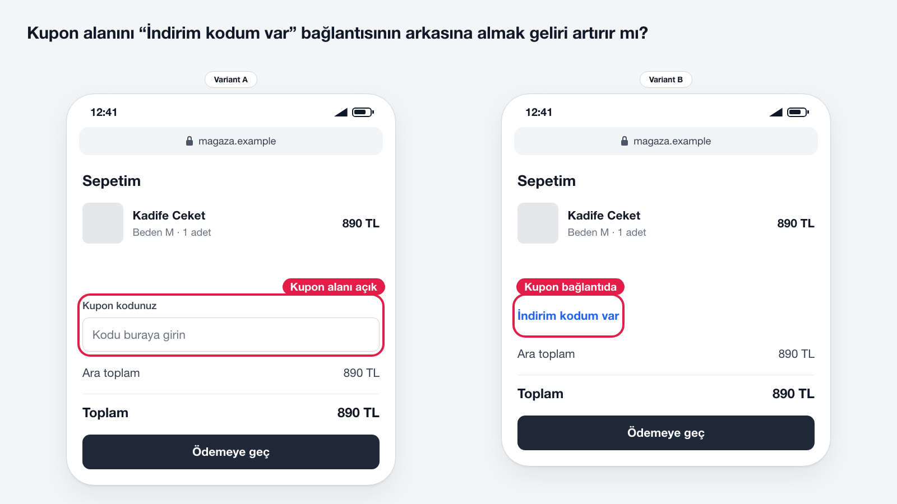

# A/B Test Builder

[](https://github.com/ali-demirbas/ab-test-playbook/actions/workflows/validate.yml)
[](LICENSE)


**Dil:** [English](README.md) · [Türkçe](README.tr.md)

Sayfanızın ekran görüntüsünü tek değişkenli A/B test planlarına çevirir. Her planda bir birincil KPI ve bir guardrail (bozulmaması gereken metrik) bulunur, plan iki ajan tarafından incelenir ve A ile B yan yana duran bir kart olarak çizilir. Claude Code içinde çalışır.

<p align="center">
  <a href="https://ali-demirbas.github.io/ab-test-playbook/"></a>
</p>

<p align="center"><sub>Gerçek bir kart, eklentinin her test için çizdiği haliyle: kurgusal mağaza, nötr renkler. <a href="https://ali-demirbas.github.io/ab-test-playbook/">Canlı demo</a> · <a href="docs/demo/">diğer örnek kartlar</a></sub></p>

- **Siz verirsiniz:** sayfanızın ekran görüntüsünü, adresini ya da kısa bir tarifini. Paylaşacak sayfa yoksa sayfa türünü söyleyin ("ödeme sayfam"), 221 senaryoluk derlenmiş arşivden fikir seçer.
- **Siz alırsınız:** bir ile üç arası test planı. Her planda tek değişiklik, neden işe yarayacağı, bir birincil KPI ve bir guardrail vardır. Plan, A ile B'nin yan yana durduğu ve değişikliğin halkayla işaretlendiği bir HTML kart olarak gelir.
- **Yapmadıkları:** örneklem, süre, anlamlılık ya da kazanan hesaplamaz, analitik ya da test aracınıza bağlanmaz, canlı sitenize dokunmaz. Sonuçlar test aracınızda kalır.

Sırada neyi test edeceğine karar veren growth, CRO ve ürün ekipleri için. Kod yazmanız gerekmez.

> **Bilinmesi gereken tek ad:** eklentinin görünen adı A/B Test Builder. `ab-test-playbook` adıyla kurulur, komutu `/ab-test`. Resmi kaynak bu repodur. Herkese açık dizinlerdeki benzer adlı skill'ler bu proje değildir.

## 3 adımda ilk kart

**Gerekenler:** Claude Code ve Python 3.9 veya üstü. Node 18 veya üstü ve Playwright yalnızca son görsel kontrol için gerekir (2. adım).

**1. Eklentiyi kurun.** Şunları Claude Code'a yazın:

```
/plugin marketplace add ali-demirbas/ab-test-playbook
/plugin install ab-test-playbook@ab-test-playbook
```

**2. Görsel kontrolü açın (isteğe bağlı, önerilir).** Terminalde bir kez çalıştırın:

```bash
npm i --prefix ~/.abtest-visual playwright && npx --prefix ~/.abtest-visual playwright install chromium
```

Bu adımı atlasanız da kartlarınızı alırsınız, "görsel olarak kontrol edilmedi" işaretli önizleme olarak. Sonradan kurarsanız aynı kartlar kontrol edilip tamamlanır.

**3. Kart isteyin.** Sayfanızın ekran görüntüsünü Claude Code'a yapıştırıp şunu yazın:

```
/ab-test bu sayfa için test tasarla
```

Elinizde ekran görüntüsü yoksa arşivden başlayın:

```
/ab-test ödeme sayfam için test öner
```

En fazla tek soru sorar (hangi problemi çözdüğünüz). Trafik, araç ya da bütçe sormaz. Yalnızca `/ab-test` yazarsanız kısa bir menü gelir.

Codex, Gemini CLI ya da claude.ai mı kullanıyorsunuz, güncelleme mi yapacaksınız, bir şey ters mi görünüyor? [Kurulum, güncelleme ve sorun giderme](docs/install.tr.md) sayfasına bakın.

## Neler isteyebilirsiniz

| Siz şöyle dersiniz | Şu olur |
|---|---|
| `/ab-test design`: "buna test tasarla" ve ekran görüntüsü, adres ya da tarif | Sayfanız için en fazla üç yeni tek değişkenli test tasarlar, her biri kartıyla gelir |
| `/ab-test suggest`: "ürün sayfam için test öner" | Arşivden uyan fikirleri seçer, yüksek, orta, düşük diye sıralar ve ilk üçünü çizer |
| `/ab-test audit`: "bu test doğru kurulmuş mu?" ve planınız | Planı trafik almadan önce denetler: tek varyantta iki değişiklik, asıl sonucun yerine geçen tıklama metriği, eksik guardrail, erişilebilirlik ve uyum açıkları, dark pattern (kullanıcıyı yanıltan tasarım) |
| `/ab-test card`: "bunu karta çevir" | Elinizdeki senaryoyu kart olarak çizer |
| "2. öneriyi detaylandır" | Tek bir önerinin ayrıntısını sohbette verir: test edilmesi gerekenler, takip edilecek KPI'lar, yapılmaması gerekenler |
| "Bu anlamlı mı?" | Kapsam dışı. Test aracınızın raporunu gösteren tek satır ve planı denetleme teklifi |

Bütün komutlar, uçtan uca bir oturum ve test hafızası dosyası (`.abtest-history.md`, kaybetmiş bir test yeniden önerilmesin diye) [başvuru](docs/reference.tr.md) sayfasında.

## Neden kullanılır

| Sistem olmadan | A/B Test Builder ile |
|---|---|
| Test fikirleri hafızadan ya da o gün akla gelenden çıkar | Fikirler 221 senaryoluk arşivden sıralı gelir ya da sayfanız için gerekçesi yazılarak tasarlanır. "Daha dikkat çekici olur" gerekçe sayılmaz |
| Varyant B sessizce iki şeyi değiştirir, sonuç açıklanamaz | Test başına tek değişken. İkinci bir incelemeci çizilen kartta gizli ikinci farkı arar |
| Beş metrik izlenir, hiçbiri kararı vermez | Kararı tek birincil KPI verir, bozulmaması gerekeni tek guardrail korur |
| Kupon alanını gizlemek geliri artırır, çünkü kodu olan artık tam fiyat öder ve bu kazanç gibi okunur | Bir kullanıcı faydasına dokunan değişiklikte gelir hedefi, o faydayı koruyan guardrail olmadan reddedilir |
| Biri isterse dark pattern yayına girer | İstense bile reddedilir, nedeni söylenir |

Karşılaştırmanın tamamı [başvuru](docs/reference.tr.md#neden-rastgele-test-etmek-yerine-bir-rehber) sayfasında.

## Onu dürüst tutan şeyler

- **Esnetmediği kurallar:** tek değişken, tek birincil KPI, en az bir guardrail, dark pattern yok, sahte referans fiyatı yok, uydurma istatistik yok. 19 bağlayıcı kural [CLAUDE.md](CLAUDE.md) dosyasında (İngilizce).
- **Kanıt etiketlidir.** Arşiv örüntüsü test etmeye değer bir fikirdir, kazanmış bir test değildir. Sezgiye sezgi denir.
- **Teslimden önce iki inceleme.** Bir ajan test planını zorlar, diğeri çizilen kartı kontrol eder. Kart ancak ikisinden sonra nihai olur. Nasıl çalıştığı [mimari](docs/architecture.md) notlarında (İngilizce).
- **Düzenlemeye tabi akışlar** (sigorta, emeklilik, kredi): zorunlu bilgilendirme, onay adımı ve kimlik doğrulama asla test konusu olmaz. Hukuki tavsiye değildir. Ayrıntı [Kapsam](docs/reference.tr.md#kapsam) başlığında.

## Dil

Skill'ler yazdığınız dilde yanıt verir, kartlar da o dilde gelir. Senaryo arşivinin kendisi Türkçedir. Metrik kısaltmaları (CR, AOV, LCP) olduğu gibi kalır.

## Daha fazlası

- [Canlı demo](https://ali-demirbas.github.io/ab-test-playbook/): Türkçe ve İngilizce örnek kartlar
- [SSS](FAQ.md): önce neyi test etmeli, guardrail, düşük trafik, sık yapılan hatalar (İngilizce)
- [Kurulum, güncelleme ve sorun giderme](docs/install.tr.md): bütün kurulum yolları ve görsel kontrol
- [Başvuru](docs/reference.tr.md): bütün komutlar, tam bir oturum, repoda ne var, kapsam
- [Örnekler](examples/): uçtan uca taşınmış bir senaryo kaydı ve hatalı bir planın denetimi
- [Katkı](CONTRIBUTING.md) · [Değişiklik günlüğü](CHANGELOG.md) · [Gizlilik](PRIVACY.md)
- Bir şey çalışmıyor mu? [Issue açın](https://github.com/ali-demirbas/ab-test-playbook/issues)

## Lisans

MIT. Kullanın, kendi işinize uyarlayın, elinizde iyi bir senaryo varsa geri gönderin. Kötü bir testi yayınlamaktan sizi kurtardıysa, bir yıldız sıradaki kişinin bunu bulmasına yardım eder.

---

[Ali Demirbaş](https://alidemirbas.com.tr) tarafından geliştirildi
