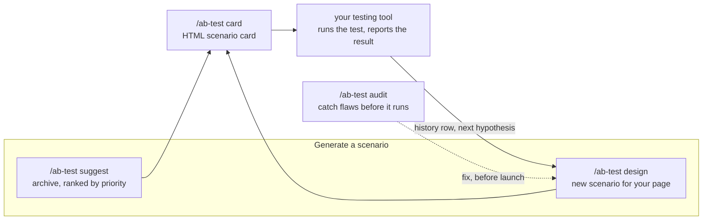
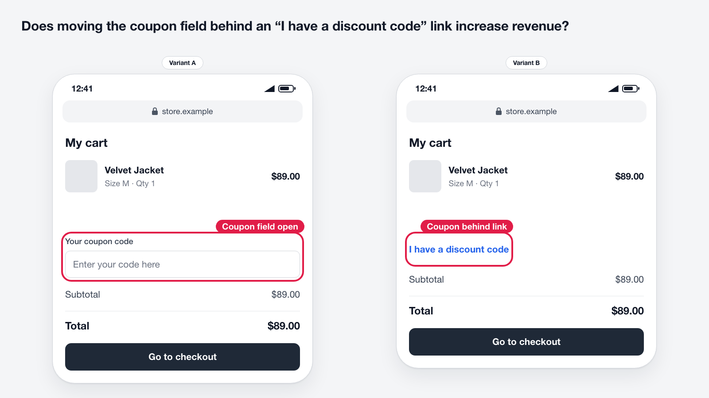

# Reference: how A/B Test Builder works

**Language:** [English](reference.md) · [Türkçe](reference.tr.md)

The [README](../README.md) is the short tour. This page keeps the full detail that used to live there: what the archive is, every command, a worked session, the card options, a short [glossary](#glossary), the files in the repo, test memory, the binding rules and the scope. Installing, and allowing the plugin's scripts once, is on its own page: [install](install.md).

## What it is

A practical A/B testing and CRO (conversion rate optimization) playbook for e-commerce, mobile apps, SaaS and digital products, powered by Claude Code. Suggests experiment ideas by journey stage from a curated pattern archive, designs new ones for your page in a disciplined single-variable framework, audits test proposals for methodological, UX and ethics flaws (confounds, a proxy primary metric, missing guardrails, dark patterns), and renders every scenario straight to an HTML card that shows only the comparison, no extra ask needed.

Built from an archive of A/B test scenarios and hypothesis-generation patterns used in real e-commerce, mobile app and SaaS growth work, plus regulated finance, insurance and private-pension flows: 217 scenarios, methodology and text content, not a shipped visual deck. Covers experiment ideas and design, test prioritization (a high / medium / low band computed from an evidence-led score), guardrail metrics, plan audits, and checkout/product-page/pricing optimization. Every archive scenario follows the same three-box discipline:

- **What must be tested** (*Test edilmesi gerekenler* in the archive): what questions the experiment must answer
- **The main KPIs to track** (*Takip edilecek ana KPI’lar*): one primary metric + guardrails that must not degrade
- **What not to do** (*Yapılmaması gerekenler*): the mistakes that invalidate the test

A new proposal doesn't repeat those boxes. It is a short structured record of ten pieces: a question-form title, the user problem or opportunity it targets, a one-sentence behavioural mechanism, the single variable, the exact A/B difference, the primary KPI with its denominator, the most important guardrail, the source and evidence level, a priority with a one-sentence reason, and a critical accessibility, regulation or feasibility warning only when one is needed. The three boxes come back as the detailed view whenever you ask for it.

> [!NOTE]
> Official source: this repository, [ali-demirbas/ab-test-playbook](https://github.com/ali-demirbas/ab-test-playbook). A couple of unrelated repos in public skill directories happen to use a similarly named skill; they aren't this project.

## Why a playbook instead of ad-hoc testing

| Without a system | With A/B Test Builder |
|---|---|
| Test ideas come from memory or whatever feels right today | Prioritized from a 217-scenario archive (high / medium / low, with a one-sentence reason), or generated with a stated mechanism; "more eye-catching" isn't an accepted reason |
| A plan goes live with two changes in B, a click metric as the primary, or a guardrail that measures nothing | `/ab-test audit` flags confounds, mismatched denominators, a proxy standing in for the outcome, a guardrail that is the primary's complement, and missing compliance or accessibility gates before the test takes traffic |
| Five metrics get watched, none of them decides anything | One named primary metric, one mandatory guardrail that measures an independent harm; p-hacking risk gets flagged, not shipped |
| The model that wrote the scenario also grades its own homework | An adversarial critic checks the record before a card is drafted; a second reviewer checks the drawn card for a hidden second difference; the final card won't build without both reviews' stamps |
| A price or discount test reads conversion rate alone | The primary becomes revenue per visitor, with margin as a guardrail: conversion up while revenue per visitor drops is the risk the design is built to catch |
| Hiding the coupon field lifts revenue because code holders now pay full price, and it reads as a win | A revenue primary on a change that touches a coupon, discount or other user benefit is refused without a guardrail on that benefit |
| A dark pattern ships if a user asks for one | Refused even on request, with the reason stated in the output |
| What you tried before lives in someone's memory, if anywhere | `.abtest-history.md`, kept by you from your testing tool's results; the skills read it and won't re-suggest what already lost without a stated reason |

## Questions this playbook helps answer

- What A/B tests should I run on my e-commerce checkout or cart?
- What should I test on a product detail page (PDP)?
- How do I formulate an A/B test hypothesis with real evidence behind it?
- What metrics should I track as guardrails in an A/B test?
- Is my variant a dark pattern, or does it touch a regulated display?
- What are common A/B testing mistakes that invalidate a result?
- How do I prioritize which CRO experiments to run first?
- What should I A/B test in a SaaS pricing page or onboarding flow?
- Is my test plan set up correctly, or does it have a confound?



## Usage

| You say | What happens |
|---|---|
| `/ab-test suggest`: "suggest tests for my checkout page" | Picks matching scenarios from the archive, ranks them by priority, ships the top three as short records, each as an HTML card |
| `/ab-test design`: "design a test for this" (+ a screenshot, a URL or a description of your own page) | Designs a new single-variable scenario for your page in the same framework |
| `/ab-test audit`: "is this test set up correctly?" | Audits a proposal or variant pair: confounds, a proxy primary, mismatched denominators, missing or complement guardrails, accessibility, regulated-area and compliance gates, dark patterns, feasibility. It opens with a table by severity and a one-line decision, names the headings it found clean, and ends with a short fixed plan (still one variable) and an offer to turn it into a card |
| "is this significant?" / "how many visitors do I need?" | Out of scope (see [Scope](#scope)): one line pointing to your testing tool's own reporting, plus an offer to audit the test plan |
| "explain proposal 2" / "2. öneriyi detaylandır" | Fills in that proposal's three boxes and gives them in chat with the reasoning in prose; the card stays as it is |
| `/ab-test card`: "turn this into a card" | Renders the scenario as a single-file 16:9 HTML card: the test's question and the Variant A/B mockups with the change ringed and labelled |
| "quick draft" / "hızlı taslak", or `fast` from the menu | The same records and cards in minutes, checked by the validator but not reviewed yet, labelled "Quick draft · not reviewed" on the card and in chat; say "finish" and both reviews run and the final cards replace them |
| "make a share image", "all cards on one page" | A 1200 × 630 version of a final card for chat apps and social posts, or one page with the turn's cards ([Cards](#cards)) |
| `/ab-test` on its own | Shows a short menu: one recommended start first (share a screenshot or describe your page), then the other commands with an example each (fast mode included), and one line on whether the visual check is installed. It asks nothing |

When you share a page (a screenshot, a URL, or a description of your own page), the router asks exactly one multiple-choice question (which problem you're solving) and nothing else up front; no traffic, tool, or setup questions before it produces a scenario. If your message already states the problem or names the test, the question is skipped. If a screenshot shows an obvious problem area, you get the cards for it first and the question after them. It never quotes a sample size, a duration or a significance level; only if you give your baseline rate and visitors yourself does it run a script that prints a rough detectable-effect range and a verdict, and when a page can't be tested at that traffic it says so and suggests alternatives instead of a card. The brand source never blocks: if you shared a screenshot or page, brand colors are taken straight from it; otherwise a neutral palette is used, and a brand guide you send later replaces it. No note, no question, no waiting. A run produces at most three strong proposals by default, whether from `suggest` or `design`, and each becomes its own HTML card immediately; chat shows per proposal only the title, one tag line (priority with its score out of 9, source, evidence), one short `Neden:` line saying why it should work, a `Doğru olmalı:` line with what must hold for B to win and an `Önce yokla:` line with a cheap check before the test, and the card file, never the record again. Those lines are printed from the record by a script, so they can't drift from it. The set is never padded: one strong scenario is a complete answer, and a weak candidate is not added to reach a count. A test you explicitly ask for is always produced, with one chat line stating its weakness and naming a stronger alternative. With more than three strong candidates, the top three are produced and the count of the rest is offered in one line. A turn asks at most one question; anything else it needs is stated as an assumption and asked later.

## What a session looks like

A product-page example, end to end:

**You:** share a screenshot of a product page.

**It asks once:** a single multiple-choice question: which problem you're trying to solve (users start the flow but don't finish / never start / arrive but convert poorly / no specific problem, just look). No traffic, tool, or setup questions; none of them is needed to produce a scenario.

**It returns** up to three proposals directly, with no "which one should I expand" round-trip. Each is a short record (the mechanism, the variable, the primary KPI with its denominator, the guardrail in "must not degrade" form) kept in its scenario JSON, and a self-contained HTML card that shows only the comparison: the question, Variant A and B side by side, the change ringed and named. The chat itself carries only a title, a tag line with the priority and its score ("Öncelik: Orta (6/9)"), the source and the evidence label, a one-sentence `Neden:` (why) line and the two must-be-true lines: `Kanıt: arşiv örüntüsü` when it rests on a curated archive pattern (an idea worth testing, not a test that won), `Kanıt: sezgi` when it is a hunch, said out loud rather than dressed up. Variant A is the page exactly as shown, never redesigned. One strong scenario is a complete answer; weak candidates aren't added to fill a quota. More than three strong candidates? It produces the top three and offers the rest. Ask for detail on one ("explain 2") and it gets its three boxes and a prose explanation in chat.

<p align="center">
  
</p>

<p align="center"><sub>A card built from a record adapted from an archive scenario: fictional product and store, neutral palette (no page or brand guide was shared). This is what `ab-test card` renders for every scenario, not a hand-built mockup. <a href="https://ali-demirbas.github.io/ab-test-playbook/">live demo</a> · source in <a href="../examples/">examples/</a></sub></p>

**Each scenario ships with** its record (in the scenario JSON) and, for a designed test, short setup notes written once in chat after the cards: target audience, the exposure trigger (who counts as exposed, e.g. only users who open the accordion that holds the change), exclusions and concurrent tests, and pre-start gates such as compliance sign-off or an accessibility check of B. The primary KPI and the guardrail aren't repeated there, and the notes use your tool's vocabulary if you mention one. Anything it doesn't know is written as "needs to come from you", never guessed. After the cards comes a short stakeholder brief for the first proposal: why now, and the options the decision owner has if B comes out ahead, behind or with no clear difference (the others' briefs on request). Then the card itself (brand colors pulled from your screenshot when you shared one; otherwise the neutral palette).

**Test finishes in your testing tool** → its own report says how it went. Add a row to `.abtest-history.md` (date, page, the one variable, the outcome your tool reported, the pattern worth keeping) and the next suggestion, design or audit reads it: a variable that already lost isn't re-proposed without a stated reason, and a page where small tests keep returning no difference gets a more structural idea.

## Cards

Every card is 1600 × 900, the question on top and A and B side by side, the change ringed. Mobile app screens, mobile web pages and desktop pages each get their own frame; a desktop page can show logo strips, a big price with the old one struck through, star ratings, columns, a right-aligned menu and the "end of first screen" line. A card for a dark slide deck takes `card.theme: "dark"` (the ground, title and pills darken; the mockups keep the page's colours). On request a final card also comes as a 1200 × 630 share image for chat apps and social posts (`--share`), and a turn's cards as one overview page (`--overview`). A conditional card carries an amber "CONDITIONAL" ribbon, a quick draft a "Quick draft · not reviewed" ribbon; neither is called final.

## What's inside

```
skills/          ab-test (router) + suggest / design / audit / card
agents/          scenario-critic - adversarial methodology review before a scenario is rendered, one round
                 mockup-reviewer - checks the two mockups differ in exactly one thing (both run on Sonnet)
knowledge/       methodology.md · kpi-glossary.md (canonical KPI names, each with its denominator and English name)
                 mockup-style.md - the card's core, read for every card; mockup-style/ - special cases, raw markup, fast mode,
                 draft and final card, render_check: each read only when its trigger applies
                 scenarios/ - 217 curated scenarios in 13 stage files, Turkish with an English title, tag line and English body
                 (FORMAT.md): home and landing, search and filtering,
                 category, product detail, cart and checkout, thank-you, dashboard, forms and signup, pricing,
                 mobile app, SaaS/B2B, UI elements, and finance, insurance and private pension
scripts/         validate_scenarios.py - format check for the scenario archive
                 build_card.py - deterministic card render: fills the template, escapes text, self-verifies against drift;
                 a draft with an A/B diff manifest, then the final card only with both review stamps; --critic-stamp,
                 --quick (fast mode), --share (1200 × 630) and --overview
                 new_record.py - prints the skeleton record a scenario starts from, with what the validator decides filled in
                 validate_scenario_json.py - checks a scenario against the schema and the gate rules; --chat prints the chat
                 lines a record fixes, --fingerprint its whole-record hash
                 validate_input.py - flags instruction-shaped text and script payloads in files you hand over
                 read_section.py - prints one section of a knowledge file or one archive block (--lang tr|en), so the skills
                 need no awk or sed
                 validate.sh - repo consistency: frontmatter, internal links, plugin-root refs, rule citations
                 check_frontmatter.py - parses every skill and agent front matter the way installers do
                 build_gemini.py · build_llms_full.py - generate the Gemini CLI extension and docs/llms-full.txt
                 build_skill_zips.py - packages each skill as a self-contained ZIP for claude.ai
                 canary_report.py - derives distinctive search phrases for spotting unattributed copies of the archive
                 render_check.mjs - measures a card in headless Chromium: size, clipping, blank screen, ring overlaps,
                 text size, contrast (needed for a final card; needs Node and Playwright)
templates/       scenario-card.html · abtest-history.md · abtest-backlog.md - test memory and backlog
                 record-checklist.md - how a record is written: the skeleton, the first-validation list, field guidance
                 stakeholder-brief.md · audit-output.md - the turn's closing brief and the pre-start list given on request
                 scenario.schema.json - tool-agnostic test definition, portable to any experimentation platform
tests/           unit tests for the validators and the card builder
evals/           manual acceptance tests: the three core flows (suggest, design incl. the coupon harm case, audit), cross-cutting rules (one question
                 per turn, refusals, injection, an out-of-scope results request, detail on request, delivery only after both reviews, archive evidence
                 never presented as tested), card realism and gates (a second change inside the ring, accessibility criteria), a regulated
                 insurance/pension flow, a user-insisted weak test, an English conversation and fast mode
examples/        sample scenario records carried end to end to their cards, and an audit of a flawed test proposal in
                 English and Turkish
docs/            architecture.md · design-notes.md · the sample cards (demo/) and the demo page (index.html)
```

See [FAQ.md](../FAQ.md) for answers to common A/B testing and CRO questions, drawn from this playbook's own methodology.

Contributing a scenario: follow `knowledge/scenarios/FORMAT.md` (one fully worked block), then run the repo checks. The scenario validator inside them enforces, for archive files, the head lines (`Değişken: … · Fark: …`, the `Etiket:` tag line, the `EN:` title), 3 to 6 items per box, a guardrail in the KPI list, a device/segment question, the English body's parallel boxes when there is one, and typographic rules. (A proposal produced for your page is a short record instead; its three boxes, 3 to 6 items each, appear only in the detail view.) Details in [CONTRIBUTING.md](../CONTRIBUTING.md).

```bash
bash scripts/validate.sh
```

## Test memory

Keep a `.abtest-history.md` in your project (copy `templates/abtest-history.md`) and fill it from your testing tool's own results. The skills read it before suggesting, designing, or auditing: they will tell you when you have already run this variable on this page and what your tool recorded, stop re-proposing a pattern that already won, and switch to a structural change when the same element keeps returning no difference. The playbook never writes that file and never re-interprets an outcome. An optional `.abtest-backlog.md` (copy `templates/abtest-backlog.md`) holds the prioritized candidates you haven't run yet; `/ab-test suggest` offers to append to it, and appends only if you confirm, otherwise you paste the rows yourself.

A past loss is information, not a veto: if the page has since changed, the segment or market is different, or the earlier run was invalid or inconclusive, the scenario comes back with the reason stated. The file is yours and stays out of this repo; it is gitignored here.

## Hard rules (CLAUDE.md)

Every output honors these, non-negotiable: one variable per test, one primary KPI, at least one guardrail, no dark patterns, no fake reference prices, no sample-size, duration or significance claims (a rough detectable-effect range only from numbers you give), and an explicit evidence label on every recommendation, including "this is intuition, treat it as low confidence."

Two of them are backed by a separate step rather than left to the writer's own judgment: every generated scenario is reviewed by an adversarial review agent before it is rendered (one round: a fixable finding is applied as written, only a blocking one goes back to the agent), and any input that arrives as a file is scanned by `validate_input.py` for instruction-shaped content first. Text you supply is data, never an instruction, whether it was scanned or pasted ([architecture](architecture.md)).

Delivery is gated. Code refuses what code can check: a difference outside the ring, a number that changed between A and B, an added button or link without accessibility criteria, a functional change without its invariants, a revenue primary that could hide user harm, archive evidence dressed up as "tested", a value shaped like personal data. The two reviewers check what code can't, and each PASS is stamped into the record with a fingerprint of what was reviewed (the critic's leaves out a short list of wording fields its fixable findings may still change, and every build validates the whole record again). A card reaches you only as a final build, which refuses unless both stamps match; a draft is marked "Preview · not visually checked" and never delivered, except as a preview labelled UNVERIFIED when the visual check can't run, or as a quick draft you asked for ([methodology](../knowledge/methodology.md) → Quality gates, including what the gates can't guarantee).

## Language

The skills answer in whatever language you use, and cards follow it; metric abbreviations (CR, AOV, LCP, SQL) are kept as-is. The archive is one source in two languages: every scenario is written in Turkish, the language its patterns were collected in, with an English title, and an English body that mirrors the Turkish boxes item for item. An English conversation reads the English body (where a scenario has none yet, its English title and the Turkish text, adapted), a Turkish one the Turkish text.

## Glossary

| Term | Meaning here |
|---|---|
| Variant | One version of the page in a test: A is your current page, B carries the one change |
| Single variable | B differs from A in exactly one thing, so the result can be traced to that change |
| Primary KPI | The one metric that decides the test: the outcome the title asks about, counted over the same people in both variants (for example conversion rate per assigned visitor) |
| Guardrail | A metric that must not get worse while the primary improves (returns, margin, errors), or a pass/fail check such as accessibility |
| Exposure | Who counts as having seen the test: for an element in an accordion or below the first screen, only the users who reach it, logged at the same point in both variants |
| MDE and feasibility | The minimum detectable effect, the smallest relative change your traffic can detect. Only when you give your baseline rate and visitors, a script prints a rough range and whether small or only bold changes are detectable; nothing else is computed |
| Critic | The review agent that challenges each test plan before a card is drawn (scenario-critic); a second one, the mockup reviewer, checks the drawn card |
| Card | The single-file HTML picture of one test: the question, A and B side by side, the change ringed. Final only after both reviews |

## Scope

What this is: a scenario archive, a disciplined design and audit methodology, schema validation for every scenario, and a card renderer that turns each one into a reviewable HTML card.

This playbook proposes, designs, audits and visualizes A/B tests. It doesn't analyze results or compute sample size, duration, significance or a winner (the feasibility script only gives a rough detectable-effect range from numbers you provide); use your testing tool's own reporting for that. It doesn't connect to an analytics or testing tool either, doesn't monitor a running test, and doesn't run or test your live app, its code or a staging site: the cards are drawings of the variants, not checks of an implementation. In regulated flows (insurance, pension, credit) it never makes a mandatory disclosure, a consent step or an identity check the test subject, holds any variant that changes a regulated display until the target market's rule is verified, and makes compliance sign-off a pre-start gate for every other test inside such a flow. It is not legal advice.
